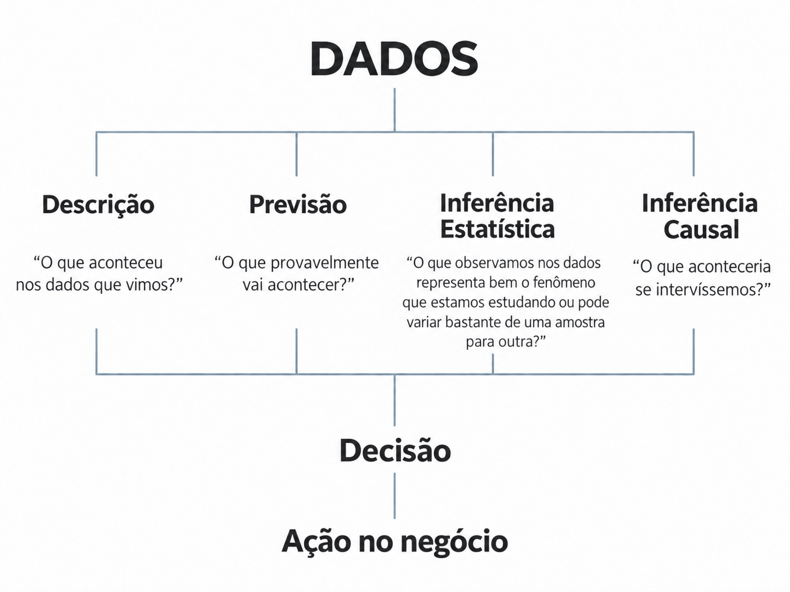

## Antes de escolher um modelo

Quando pensamos em Data Science, é comum começar pelos modelos mais famosos de *Machine Learning*:

- regressão;
- random forest;
- XGBoost;
- redes neurais;
- etc.

Mas essa **não deveria** ser a primeira pergunta.

Antes de perguntar:

> *Qual modelo devemos usar?*

precisamos perguntar:

> **O que queremos aprender com os dados?**

A resposta depende do tipo de pergunta que queremos responder e da decisão que será tomada a partir dela.

{.course-figure width="70%"}

Imagine uma empresa preocupada com **churn**. Ela pode fazer quatro perguntas diferentes:

1. **Descrição:** Qual foi a taxa de churn no último trimestre?
2. **Previsão:** Quais clientes provavelmente vão cancelar?
3. **Inferência Estatística:** A taxa observada representa bem o nível de churn dos nossos clientes ou pode variar bastante de uma amostra para outra?
4. **Inferência Causal:** Se oferecermos um benefício, quanto o churn diminuirá por causa dessa intervenção?

As quatro perguntas usam dados. Algumas podem até utilizar os mesmos modelos. Mas são problemas diferentes.

> **A pergunta vem antes do modelo.**

## 1. Descrição: o que aconteceu nos dados que vimos?

### A pergunta

Às vezes queremos apenas resumir aquilo que já observamos.

Por exemplo:

- Qual foi a taxa de churn no último trimestre?
- Quantos usuários converteram nesta campanha?
- Qual foi a receita média por cliente?
- Qual segmento teve maior conversão?
- Quantos pedidos foram entregues com atraso?

Se tivemos 10.000 clientes no trimestre e 1.000 cancelaram, então a taxa observada de churn foi **10%**.

Esse número descreve aqueles dados. Não precisamos de Inferência Estatística para afirmar isso.

O ponto importante é distinguir:

> **descrever o que aconteceu nos dados observados**

 de

> **usar esses dados para aprender algo que vai além deles.**

Essa segunda pergunta é justamente onde começa a **Inferência Estatística**.

### Por que uma empresa quer descrever os dados?

Porque antes de prever, inferir ou estimar efeitos causais, precisamos entender o que aconteceu.

Descrição aparece em praticamente todo trabalho de dados:

- dashboards;
- KPIs;
- relatórios;
- monitoramento de produto;
- acompanhamento de receita;
- análise de funil;
- comparação entre períodos e segmentos.

::: {.callout-note}
## Ideia principal

**Descrição** responde ao que aconteceu nos dados que observamos. Ela não exige, por si só, generalizar para uma população, prever novas observações ou interpretar relações como causais.
:::

## 2. Previsão: o que provavelmente vai acontecer?

### A pergunta

Em problemas preditivos, queremos antecipar um resultado ainda desconhecido.

Por exemplo:

- Esse cliente vai cancelar?
- Essa transação é fraude?
- Esse usuário provavelmente vai comprar?
- Quanto vamos vender no próximo mês?
- Quanto tempo essa entrega vai levar?
- Qual lead provavelmente vai converter?
- Qual produto devemos recomendar para esse usuário?

O objetivo é aprender, a partir dos dados observados, uma função $f$ capaz de transformar informações disponíveis ($X$) em uma boa previsão de $Y$ para casos novos.

Uma forma **geral** de representar essa relação é:

$$
Y = f(X) + \epsilon
$$

Quando o objetivo é **previsão**, o principal é que a função aprendida produza boas previsões e **generalize para novos dados**.

Ou seja:

> quando chegarem novas observações de $X$, conseguiremos prever bem seus respectivos valores de $Y$ por meio da regra $f$ aprendida?

### Por que uma empresa quer prever algo?

Porque antecipar um acontecimento permite agir antes que ele ocorra.

- prever churn → priorizar clientes para retenção;
- prever fraude → bloquear ou revisar transações;
- prever demanda → organizar estoque e operação;
- prever conversão → priorizar leads;
- prever interesse → personalizar recomendações.

Prediction normalmente nos leva para o campo de **Statistical Learning e Machine Learning**.

Entre os principais fundamentos estão:

- **Teoria da Probabilidade**;
- álgebra linear;
- cálculo e otimização;
- loss functions;
- train, validation e test;
- generalização;
- overfitting e regularização;
- cross-validation;
- métricas de performance;
- algoritmos de Machine Learning.

Em um problema puramente preditivo, o objetivo principal não é estimar uma quantidade populacional e quantificar sua incerteza, mas construir uma função que **generalize bem para novos dados**.

Por isso, Inferência Estatística não é, **em geral**, um pré-requisito para construir um bom modelo preditivo.

Mas ela pode aparecer depois, quando mudamos a pergunta. Ela pode aparecer **também dentro de um problema preditivo**, como uma camada necessária da avaliação do que foi feito.

Suponha que dois modelos de churn tenham AUCs de 0,81 e 0,83 na mesma amostra de teste.

Se perguntamos:

> **Qual modelo teve melhor performance observada?**

estamos apenas comparando resultados observados.

Mas, se perguntamos:

> **Essa diferença de 0,02 provavelmente se mantém para novos casos ou pode ser apenas resultado da amostra utilizada?**

entramos em um problema de **Inferência Estatística**.

Mais abaixo, você vai entender que essa pergunta tem **algo implícito muito importante**:

- Para saber o que acontece em novos casos, seria interessante saber mais sobre o "_Processo da Natureza que Gerou os Dados_".

Porém, como normalmente não é possível ter esse conhecimento no mundo real, usamos uma amostra para inferir algo sobre esse **Processo Gerador de Dados**.

::: {.callout-note}
## Ideia principal

**Previsão** cria valor quando antecipar corretamente um acontecimento permite à empresa agir melhor antes que ele ocorra.
:::

## 3. Inferência Estatística: o que podemos aprender além dos dados observados?

### A pergunta

Agora a pergunta muda.

Não queremos apenas descrever os dados que já vimos nem necessariamente prever o resultado de uma nova observação individual.

Queremos usar os dados observados para **aprender alguma quantidade desconhecida sobre uma população ou sobre o processo que gera os dados**.

*Por que isso é necessário?*

Imagine que alguém pergunte:

> **Qual é a verdadeira taxa de churn dos nossos clientes?**

Essa quantidade pertence ao **processo gerador dos dados** — o *data-generating process* (DGP).

Se conhecêssemos completamente esse processo, saberíamos exatamente com que probabilidades os diferentes resultados são gerados e poderíamos calcular diretamente a taxa de churn que nos interessa.

Não precisaríamos estimá-la a partir dos dados observados.

Na prática, porém, **não conhecemos o DGP**.

O que observamos é apenas **uma realização desse processo**: uma amostra de clientes, transações, usuários ou eventos.

É a partir dessa amostra que tentamos aprender alguma característica desconhecida do processo maior que gerou os dados.

É justamente aí que entra a **Inferência Estatística**:

> usar os dados observados para aprender sobre uma quantidade desconhecida da população ou do processo gerador dos dados, e quantificar a incerteza dessa conclusão.

Por exemplo:

- A taxa de churn observada representa bem o nível de churn dos nossos clientes?
- A conversão média observada neste período é uma boa aproximação do que esperamos de forma mais geral?
- A diferença de conversão entre dois grupos parece real ou pode ser apenas variação dos dados?
- O churn realmente aumentou ou estamos observando uma flutuação compatível com a variabilidade do processo?

Aqui está a distinção essencial:

> **Se calculamos apenas uma métrica nos dados observados, estamos descrevendo esses dados.**

A Inferência Estatística começa quando queremos usar essa métrica para dizer algo **além da amostra observada**.

### Um exemplo com churn

Suponha que tivemos 10.000 clientes neste trimestre e 1.000 deram churn.

A taxa observada foi:

> **10%**

Se a pergunta é:

> Qual foi a taxa de churn desses 10.000 clientes?

acabou o problema: **10%**. Isso é Estatística Descritiva.

Mas a empresa pode querer usar esse número para planejamento, metas ou decisões futuras.

A pergunta passa a ser algo como:

> **Esse churn de 10% representa bem o nível de churn que devemos esperar dos nossos clientes de forma mais geral?**

Agora existe incerteza.

Outra amostra de clientes, outro período ou outra realização do mesmo processo poderia produzir 9%, 11%, 13% ou outro valor.

Os 10% observados passam então a ser usados como uma **estimativa** de uma quantidade que não observamos diretamente: o nível de churn subjacente da população ou do processo que gera esses clientes.

É nesse momento que entram conceitos como:

- estimador;
- distribuição amostral;
- erro padrão;
- intervalo de confiança;
- testes de hipóteses.

Uma maneira intuitiva de pensar nisso é:

> os clientes que já deram churn pertencem ao passado. Para saber o que aconteceu com eles, basta olhar os dados. A Inferência Estatística aparece quando usamos esses clientes para aprender algo que queremos transportar para além deles — inclusive para clientes e períodos que ainda não observamos.

### Por que uma empresa quer fazer inferência?

Porque métricas variam, mas **nem toda variação observada significa que o negócio realmente mudou**.

Conversão muda de uma semana para outra. Churn muda de um mês para outro. Receita média muda entre amostras. Segmentos apresentam resultados diferentes.

Parte dessa variação pode simplesmente ser consequência da **incerteza inerente ao processo gerador dos dados**. Mesmo que nada relevante tenha mudado no negócio, diferentes amostras produzidas pelo mesmo processo não serão exatamente iguais.

Considere um exemplo simples: *lançar um dado e observar o resultado*. Se conhecêssemos completamente o **processo gerador dos dados**, saberíamos a probabilidade de cada resultado. Ainda assim, não saberíamos antecipadamente qual número aparecerá em uma determinada jogada.

Essa é a **incerteza inerente ao processo**: mesmo conhecendo perfeitamente suas probabilidades, diferentes realizações podem produzir resultados diferentes. Podemos observar 1, depois 3, depois 1 novamente, sem que nada tenha mudado no dado ou no processo que o gera.

Mas conhecer essas probabilidades nos daria algo fundamental: saberíamos **qual variação é normal e esperada para aquele processo** e poderíamos tomar decisões com base nessa estrutura.

Nas empresas (_ou no mundo real em geral_), o problema é que normalmente **não conhecemos o processo gerador nem suas probabilidades**. Temos apenas os dados que ele produziu e tentamos aprender sobre o processo a partir deles usando **inferência estatística**.

Por isso, observar que a conversão caiu de 10% para 9,7% não é suficiente para concluir que houve uma mudança real. Talvez alguma coisa tenha mudado. Mas talvez o mesmo processo, funcionando exatamente como antes, pudesse naturalmente produzir 10% em uma amostra e 9,7% em outra.

Uma função importante da **Inferência Estatística** é justamente quantificar essa incerteza e ajudar a separar:

> **_uma diferença que sugere uma mudança no processo gerador de dados_**

de

> **_uma diferença ainda compatível com a variabilidade que o próprio processo pode gerar_.**

Se tratarmos toda variação observada **como uma mudança real do negócio** (ou seja, como algo inerente do processo gerador de dados do negócio), podemos reagir a **ruído**.

Essa distinção ajuda a evitar decisões precipitadas e a entender melhor o que os dados realmente permitem concluir.

### O que precisamos aprender para fazer Inferência Estatística?

A **Teoria da Probabilidade** fornece a linguagem matemática para representar incerteza e raciocinar sobre o que poderia acontecer se repetíssemos o processo de geração e amostragem dos dados.

Depois entram conceitos como:

- amostragem;
- estatísticas e estimadores;
- distribuições amostrais;
- Lei dos Grandes Números;
- Teorema Central do Limite;
- erro padrão;
- estimação;
- propriedades de estimadores;
- intervalos de confiança;
- testes de hipóteses;
- p-values;
- erros Tipo I e Tipo II.

Essa construção permite transformar:

> "observamos este número"

em algo como:

> "com base nos dados e nas hipóteses do nosso modelo, esta é nossa melhor estimativa da quantidade de interesse e esta é a incerteza associada a ela."

::: {.callout-note}
## Ideia principal

**Descrição** diz o que aconteceu nos dados que vimos. **Inferência Estatística** usa os dados que vimos para aprender sobre aquilo que não observamos completamente, quantificando a incerteza dessa passagem.
:::

## 4. Inferência Causal: o que aconteceria se fizéssemos alguma coisa?

### A pergunta

Agora a pergunta muda novamente.

Empresas não querem apenas observar ou prever o mundo. Elas querem **agir sobre ele**.

Elas:

- mudam preços;
- lançam features;
- enviam campanhas;
- oferecem descontos;
- alteram interfaces;
- mudam processos;
- criam políticas;
- modificam algoritmos.

E então surge uma pergunta diferente:

> O que mudou **por causa** da nossa ação?

Exemplos:

- Se oferecermos um cupom, quanto aumentam as compras?
- Se mudarmos a tela de checkout, quanto aumenta a conversão?
- Se aumentarmos o preço, quanto muda a demanda?
- Essa campanha aumentou a receita?
- Esse novo onboarding reduziu churn?

A expressão fundamental aqui é:

> **por causa de.**

Não queremos saber simplesmente se duas coisas aparecem juntas, mas se mudar uma delas **provoca** uma mudança na outra.

### The Jump of the Cat: Associação não é intervenção

Imagine que clientes que recebem cupons compram mais.

Isso não significa necessariamente que:

> os cupons fizeram esses clientes comprarem mais.

Talvez a empresa ofereça cupons justamente aos seus melhores clientes, que já comprariam mais mesmo sem o cupom.

Da mesma forma:

> usuários que utilizam determinada feature possuem maior retenção.

Isso não significa necessariamente que:

> fazer um usuário utilizar essa feature aumentará sua retenção.

Talvez usuários naturalmente mais engajados sejam justamente aqueles que utilizam a feature.

**Inferência Causal** tenta responder:

> O que teria acontecido com essas mesmas unidades se a intervenção tivesse sido diferente?

Essa é a ideia do **contrafactual**.

### Previsão não é Inferência Causal

Imagine dois clientes.

Cliente A:

- 90% de probabilidade prevista de churn;
- praticamente nenhuma resposta a uma intervenção de retenção.

Cliente B:

- 40% de probabilidade prevista de churn;
- sua probabilidade poderia cair para 10% se recebesse a intervenção.

Se a empresa olhar apenas para previsão, provavelmente priorizará A.

Mas, se a pergunta for:

> "Em quem essa intervenção terá maior impacto?"

B pode ser o cliente mais interessante.

Portanto:

> **alto risco previsto não significa alto efeito causal.**

### O que precisamos aprender para fazer Inferência Causal?

Inferência Causal não substitui Inferência Estatística. Ela se apoia nela e acrescenta uma nova camada.

Além dos fundamentos de Probabilidade e Inferência Estatística, entram conceitos como:

- treatment;
- outcome;
- potential outcomes;
- counterfactual;
- treatment effect;
- randomização;
- confounding;
- identification;
- selection bias;
- experiments e A/B tests;
- dados observacionais;
- Difference-in-Differences;
- Instrumental Variables;
- Regression Discontinuity;
- matching e weighting;
- heterogeneous treatment effects;
- Causal Machine Learning.

Há uma distinção particularmente importante:

**Inferência Estatística** ajuda a responder:

> "Com que precisão estimamos esta quantidade?"

**Inferência Causal** precisa primeiro responder:

> "Esta quantidade pode ser interpretada como efeito causal?"

Só depois estimamos esse efeito e quantificamos sua incerteza.

::: {.callout-important}
## Identificação vem antes da estimação

Um intervalo de confiança extremamente preciso em torno da quantidade errada continua não respondendo à pergunta causal.

Inferência Causal exige não apenas estimar bem, mas justificar por que a quantidade estimada representa o efeito da intervenção que queremos conhecer.
:::

::: {.callout-note}
## Ideia principal

**Inferência Causal** cria valor quando precisamos descobrir quais ações realmente provocam mudanças nos resultados que importam para a empresa.
:::

## O mesmo problema de churn, quatro perguntas diferentes

Agora podemos voltar ao mesmo exemplo e separar claramente os quatro tipos de pergunta:

| Pergunta da empresa | O que queremos aprender? | Tipo de problema |
|---|---|---|
| **"Qual foi nosso churn no último trimestre?"** | O que aconteceu com os clientes observados. | **Descrição** |
| **"Quais clientes provavelmente vão dar churn?"** | O resultado provável para novos casos. | **Previsão** |
| **"Observamos churn de 10%. Esse número representa bem o nível de churn dos nossos clientes ou pode variar bastante?"** | Uma quantidade que vai além da amostra observada e a incerteza associada. | **Inferência Estatística** |
| **"Se oferecermos um benefício, o churn diminuirá? Quanto?"** | O efeito de uma intervenção. | **Inferência Causal** |

A diferença pode ser resumida assim:

> **Descrição:** o que aconteceu?
>
> **Previsão:** o que provavelmente vai acontecer?
>
> **Inferência Estatística:** o que podemos aprender além dos dados que observamos, e com qual incerteza?
>
> **Inferência Causal:** o que aconteceria se mudássemos alguma coisa?

## Um mapa mental

Quando você se deparar com um novo problema de Data Science, comece pelas perguntas:

### Quero apenas resumir o que aconteceu?

> O que aconteceu nos dados que observamos?

**Descrição**

---

### Quero antecipar um resultado?

> O que provavelmente vai acontecer?

**Previsão**

---

### Quero aprender algo que vai além dos dados observados e quantificar a incerteza?

> O que os dados me permitem concluir para além da amostra?

**Inferência Estatística**

---

### Quero saber o efeito de mudar alguma coisa?

> O que aconteceria se eu interviesse?

**Inferência Causal**

---

E somente depois pergunte:

> Qual método ou modelo devo utilizar?

## O modelo não define a pergunta

É importante não associar automaticamente determinados algoritmos a determinados paradigmas.

Por exemplo:

> regressão = Inferência Estatística

ou

> XGBoost = Previsão.

Uma regressão pode ser utilizada para **Previsão**, **Inferência Estatística** ou dentro de uma **análise causal**.

Machine Learning também pode ser utilizado dentro de Inferência Causal.

Portanto:

> **o algoritmo não define o problema. A pergunta define o problema.**

O modelo é uma ferramenta escolhida depois que sabemos o que queremos aprender.

## E onde entra Bayesian Statistics?

Bayesian Statistics não constitui uma quinta categoria paralela às quatro anteriores.

Ela oferece outra maneira de representar e atualizar incerteza a partir de dados.

Métodos bayesianos podem ser utilizados em:

- Previsão;
- Inferência Estatística;
- Inferência Causal;
- decision making.

Neste momento, basta guardar que:

> "Bayesian" e "Frequentist" dizem respeito a frameworks de inferência, e não substituem a distinção entre descrever, prever, inferir e estimar efeitos causais.

Voltaremos a essas ideias posteriormente. Porém, não entraremos em Bayesian Statistics neste curso.

## O tamanho da empresa ou o modelo de negócio importa?

Não necessariamente.

Grandes empresas digitais frequentemente possuem condições particularmente favoráveis:

- muitos usuários;
- muitas interações;
- muitas decisões repetidas;
- boa instrumentação;
- infraestrutura de experimentação.

Por isso vemos empresas como iFood, Nubank, Amazon, Uber, Booking e Netflix utilizando intensamente Machine Learning, Experimentação e Inferência Causal.

Mas o tamanho da empresa ou o fato de ela ser B2B ou B2C não determina sozinho quais perguntas podem ser feitas.

Uma empresa pequena pode possuir milhões de observações, enquanto uma empresa enorme pode ter pouca informação para uma pergunta específica.

Também é importante lembrar:

> **número de linhas não é necessariamente o tamanho efetivo da amostra.**

Uma base pode conter 20 milhões de eventos produzidos por apenas algumas centenas de empresas.

Se a intervenção acontece no nível da empresa, o número relevante de unidades pode ser muito menor que 20 milhões.

O que importa é a combinação entre:

- pergunta de negócio;
- unidade de análise;
- unidade de intervenção;
- quantidade de informação independente;
- qualidade dos dados;
- capacidade de medir outcomes;
- valor econômico da resposta.

## Onde este curso se encaixa?

Este curso **não é um curso de Machine Learning preditivo**.

Nosso caminho será direcionado principalmente para:

> **Inferência Estatística e Inferência Causal.**

Para chegar até elas, construiremos as fundações necessárias:

**Matemática**

↓

**Teoria da Probabilidade**

↓

**Inferência Estatística**

↓

**Regressão**

↓

**Inferência Causal**

Começaremos com Matemática e Teoria da Probabilidade, porque precisamos de uma linguagem rigorosa para representar incerteza.

Depois estudaremos Inferência Estatística, aprendendo como dados observados podem ser utilizados para aprender sobre quantidades que vão além da amostra e como quantificar a incerteza dessas conclusões.

Estudaremos Regressão, uma das ferramentas mais importantes para modelar relações entre variáveis e uma ponte fundamental para Inferência Causal.

Finalmente chegaremos à Inferência Causal, onde adicionaremos uma nova pergunta:

> O que aconteceria se intervíssemos no mundo?

## Para guardar

Antes de escolher qualquer modelo, pergunte:

> **O que queremos aprender com os dados?**

**Descrição**

O que aconteceu nos dados que vimos?

→ Ajuda a empresa a **entender e medir o que aconteceu**.

**Previsão**

O que provavelmente vai acontecer?

→ Ajuda a empresa a **antecipar**.

**Inferência Estatística**

O que podemos aprender além dos dados observados e com qual incerteza?

→ Ajuda a empresa a **generalizar sem tratar uma métrica observada como verdade exata sobre o todo**.

**Inferência Causal**

O que aconteceria se fizéssemos alguma coisa?

→ Ajuda a empresa a **descobrir quais ações realmente mudam resultados**.

Modelos vêm depois. **Primeiro vem a pergunta**.
